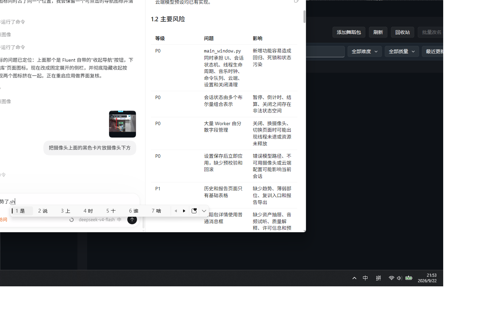

# DanceMirror 舞镜

DanceMirror 是一个基于 PyQt6 的比赛型多模态舞蹈训练桌面项目。真人舞蹈视频先离线转换为可复用动作包，训练和指挥中心的大画面始终只显示一个 3D 机器人；摄像头前的人只以二维骨架参与评分和实时重定向，不生成用户 3D 人物。

## 界面预览



项目界面包含舞蹈包库、动作解析、机器人指挥中心、训练评分和安全控制等核心流程。

## 最终交互边界

- 学习舞蹈：大画面是视频动作包驱动的 3D 机器人，左上角是用户二维骨架。
- 机器人指挥中心：大画面是实时模仿或执行舞蹈包的 3D 机器人，左上角是用户二维骨架。
- 机器人骨架在骨架、人体和叠加模式中始终可见。
- 同一时刻只允许一个 3D 角色，避免 6GB 显存设备同时承担两个实时角色。
- 不内置或分发蜘蛛侠、奥特曼等受保护 IP 角色；只支持用户导入已授权的本地 GLB。

## 当前能力

- 舞蹈包卡片库：封面海报、选择、重命名、删除、换海报、配乐和来源详情。
- 真人视频离线解析：YOLO Pose、COCO-17 骨架、时间对齐、保守 3D 提升和质量等级评估。
- 版本化 `*.dmotion.json` 动作包，音乐、BPM、节拍、海报和许可证信息随包管理。
- 学习舞蹈游戏化流程：3、2、1 倒计时、OK 手势快速开始、速度、暂停、完成度、分部位评分和薄弱片段入口。
- 音乐主时钟同步：用户补偿、处理延迟平滑、跨机位比较和低置信度证据降权。
- 机器人指挥中心：实时模仿、全身或局部范围、镜像、平滑、安全保持和紧急停止。
- 自然语言指挥：本地高频命令优先，复杂文本才进入云端结构化规划；本地重新验证所有命令和参数。
- 本地或云端 TTS；云端 ASR；复杂语言命令和训练总结共用可配置的 OpenAI-compatible 接口。
- 内置 CC0 机器人模型和五套材质皮肤；支持导入 50 MB 以内的授权本地 GLB。
- SQLite 历史记录、可选本地录像、多人隐私遮蔽和低功耗降级。
- Three.js 资源本地化，竞赛现场断网时仍可渲染主场景。

## 目录

```text
src/dance_mirror/
  capture/       摄像头与视频输入
  pose2d/        YOLO Pose 边界
  pose3d/        保守 3D 动作提升与质量证据
  motion/        归一化、比较空间、同步、特征、评分、重定向
  command/       白名单命令、严格 JSON 计划校验和优先队列
  coaching/      教练策略、本地/云端 TTS、训练报告和云端指令规划
  multimodal/    MediaPipe 手势、摄像头预览和就位判断
  privacy/       多人物遮蔽
  renderer/      Three.js 场景文档、单机器人和渲染桥
  storage/       版本化动作包与 SQLite
  workers/       QThread Worker 和外部服务边界
  view/          PyQt6 页面、3D 容器、卡片库和设置页
tests/           核心逻辑、命令安全、资源库和渲染契约测试
docs/            环境、决策、架构和 V2 至 V10 升级方案
scripts/         启动、诊断、依赖安装和验证脚本
```

## 快速运行

目标环境：

```text
C:\Users\Administrator\.conda\envs\pytorch_cuda_env
```

推荐直接运行：

```powershell
.\scripts\run.ps1
```

首次部署视觉依赖并校验本地 YOLO 权重：

```powershell
.\scripts\install_vision.ps1
```

环境诊断与完整验证：

```powershell
.\scripts\doctor.ps1
.\scripts\verify.ps1
```

发布前静态安全检查和目标机器交付清单：

```powershell
.\scripts\release_check.ps1
```

完整发布流程、资源许可证边界和比赛验收步骤见 [docs/RELEASE_GUIDE.md](docs/RELEASE_GUIDE.md)。

完整安装和 CUDA 配置见 [docs/ENVIRONMENT.md](docs/ENVIRONMENT.md)。已确认需求见 [docs/DECISIONS.md](docs/DECISIONS.md)，模块边界和线程约束见 [docs/ARCHITECTURE.md](docs/ARCHITECTURE.md)，实现契约见 [docs/OPTIMIZATION_AND_IMPLEMENTATION_PLAN_V10.md](docs/OPTIMIZATION_AND_IMPLEMENTATION_PLAN_V10.md)。

## 使用流程

1. 在设置页配置 YOLO 权重、推理设备、摄像头视角、用户延迟补偿和云服务。
2. 在舞蹈包库点击“添加舞蹈包”，选择有授权的真人舞蹈视频和可选音乐。
3. 等待离线解析完成；卡片会显示海报、时长、BPM、难度和质量等级。
4. 双击卡片进入学习舞蹈页，全身进入左上角摄像头画面后点击开始或做 OK 手势。
5. 观察机器人标准动作、二维骨架、分部位得分、节拍和语音纠错。
6. 打开机器人指挥中心进行实时模仿、语音控制、皮肤和场景切换。
7. 训练结束后查看历史分数；配置云模型时生成结构化训练报告。

## 关键工程约束

- 主线程只处理 UI 和信号，网络、模型、视频、数据库和文件 IO 均进入 Worker。
- 子线程只发送纯数据，不创建或修改 `QWidget`、`QPixmap` 或 `QWebEngineView`。
- 云端 LLM 只能返回短小 JSON；命令、参数、动作包 ID 和数值范围全部在本地重新校验。
- 紧急停止、停止模仿和暂停命令永远走本地快速通道，不经过云端规划。
- 每帧评分保留在本地；云端只处理非逐帧的训练摘要和复杂语言解析。
- MediaPipe 手势按间隔采样，与 YOLO、WebGL 和 TTS 共同遵守 6GB 显存预算。
- API Key 只保存在当前进程内存，不写入项目配置文件。
- 关闭窗口时停止计时器、Worker、摄像头、音乐和 WebEngine，并等待线程退出。

## 许可提醒

PyQt6、PyQt6-Fluent-Widgets、Ultralytics、MediaPipe 和 Three.js 都有各自的许可证要求。比赛、演示或商业发布前必须完成许可证核查。参考视频、音乐、机器人模型和动作数据也必须获得授权，项目不会自动下载或分发受保护 IP 角色。
